<div align="center">


# CICM · Central de Comissões

**Case de UX/UI e front-end: conferência, correção e reenvio de comissões de corretagem para um grupo segurador.**

[](https://github.com/fernandopinhel/CICM/actions/workflows/ci.yml)


[Ver o protótipo](https://fernandopinhel.github.io/CICM/) ·
[Como rodar](#como-rodar-localmente) ·
[O case](#o-case)

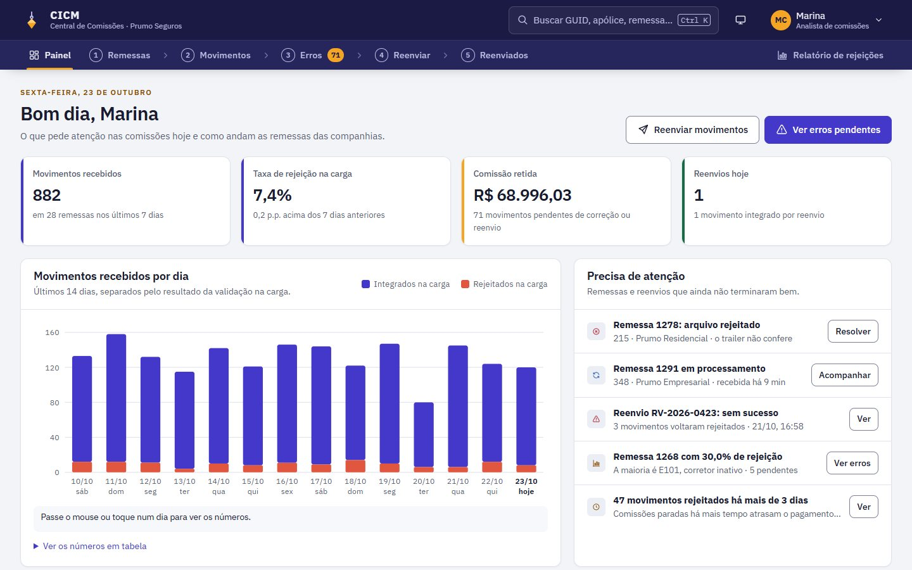

</div>

> **Este é um case de portfólio.** O projeto nasceu em 2019, numa empresa onde trabalhei,
> e foi recriado aqui para mostrar o processo e o resultado. Para preservar a empresa e o
> cliente, a interface usa o grupo segurador fictício **Prumo Seguros**. Companhias,
> corretores, apólices, GUIDs, códigos de erro, tabelas e valores são todos de exemplo, e
> nada do que você digita sai do seu navegador.

---

## Sumário

- [O case](#o-case)
  - [Contexto e problema](#contexto-e-problema)
  - [Objetivo](#objetivo)
  - [Decisões de design](#decisões-de-design)
  - [A marca fictícia](#a-marca-fictícia)
  - [Revisitando o case](#revisitando-o-case)
- [A jornada, tela a tela](#a-jornada-tela-a-tela)
- [O que funciona no protótipo](#o-que-funciona-no-protótipo)
- [Acessibilidade](#acessibilidade)
- [Tecnologias e arquitetura](#tecnologias-e-arquitetura)
- [Testes](#testes)
- [Como rodar localmente](#como-rodar-localmente)
- [Publicação no GitHub Pages](#publicação-no-github-pages)
- [Segurança e privacidade](#segurança-e-privacidade)
- [Limitações](#limitações)
- [Próximos passos](#próximos-passos)
- [Histórico](#histórico)
- [Autor](#autor)

---

## O case

### Contexto e problema

Num grupo segurador, cada companhia (auto, vida, residencial, empresarial) calcula a
comissão dos corretores parcela a parcela e manda tudo, todo dia, num **arquivo de
remessa** para uma central. A central valida cada **movimento** (uma comissão de uma
parcela de uma apólice) e integra os bons no sistema que paga os corretores. Os que
falham ficam **rejeitados**, e a comissão fica parada até alguém resolver.

A CICM, Centralização de Comissões, é a ferramenta da equipe que faz esse trabalho. A
versão de 2019 tinha as telas certas (resumo de processamento, consulta de movimentos,
reenvio, consulta de reenviados, detalhe de erro e relatório), mas cada uma era um
formulário solto que devolvia uma tabela:

- o erro aparecia como **código técnico** (o nome do campo e da tabela do banco), sem dizer o que fazer;
- não havia como **corrigir** o dado no próprio sistema: o reenvio era às cegas;
- para reenviar era preciso **digitar o GUID** de 17 caracteres de cada caso;
- depois do reenvio, não se sabia se tinha dado certo sem consultar de novo;
- nada mostrava **quanto dinheiro** estava retido nem o que pedia atenção primeiro.

### Objetivo

Transformar as telas numa **jornada** só, da chegada da remessa ao pagamento:

1. ver, ao abrir, o que precisa de atenção e quanto de comissão está parado;
2. entender cada erro em linguagem clara, com **como resolver**;
3. **corrigir** aqui o que dá para corrigir aqui, e saber o que só a companhia resolve;
4. **prever** o resultado antes de reenviar e reenviar em lote, sem digitar GUID;
5. acompanhar o reenvio **ao vivo** e ver o resultado de cada movimento;
6. ter um relatório que sirva de pauta para conversar com as companhias.

### Decisões de design

| Decisão | Por quê |
| --- | --- |
| **Navegação em forma de fluxo** (1 Remessas › 2 Movimentos › 3 Erros › 4 Reenviar › 5 Reenviados) | As telas existiam, mas soltas num menu de siglas. Numerar as etapas mostra o caminho da comissão e onde cada tela entra nele. |
| **"Como resolver" em cada erro**, em quatro tipos: corrigir aqui, basta reenviar, corrigir na companhia, descartar | O código `CD_OPCAO_COML` não diz nada a quem não conhece o banco. O tipo de solução diz o próximo passo e evita reenvios inúteis. |
| **Previsão do reenvio** ("deve integrar" ou "deve voltar rejeitado") | O CICM revalida o movimento antes de reenviar. Quem vai reenviar sabe o resultado antes e desmarca o que ainda vai falhar. |
| **Conferência antes de confirmar** | Reenviar é uma ação em lote, que mexe com pagamento. A pessoa vê totais, previsões e motivos de exclusão antes do clique final. |
| **Correção no próprio caso**, com o limite do ramo e o valor recalculado na hora | O erro "comissão acima do limite" vira um campo com o limite ao lado e a comissão nova em reais. O dado errado e o certo ficam no histórico. |
| **Seleção em lote nas listas de erros e movimentos** | Ninguém precisa copiar e colar GUID. A lista colada continua existindo para quem recebe GUIDs por e-mail. |
| **Protocolo com progresso ao vivo** e aviso ao terminar | O reenvio leva alguns segundos. A pessoa pode continuar trabalhando e recebe o resultado em um aviso com link. |
| **Comissão retida** como indicador | Mostra o impacto em reais e ajuda a priorizar: um erro em 30 movimentos de vida em grupo pesa mais do que um em 2 de automóvel. |
| **Paleta de comandos** (`Ctrl+K`) | Quem trabalha com GUID, apólice, remessa e protocolo o dia todo chega direto ao caso, sem passar por formulário. |
| **IBM Plex Mono** em GUIDs, códigos e números | São dados para conferir caractere a caractere. Fonte mono, números tabulares e alinhamento à direita evitam erro de leitura. |
| **Tema escuro e tabelas compactas** | É uma ferramenta de uso contínuo. A densidade compacta mostra o dobro de linhas e o tema escuro cansa menos em turnos longos. |
| **Menos campos obrigatórios** | Na consulta por caso, endosso e parcela viraram opcionais. Os filtros sintéticos têm valores padrão e a consulta já abre com resultado. |

### A marca fictícia


**Prumo Seguros** é um grupo segurador inventado para o case. O **prumo** é o peso na
ponta de um fio que os pedreiros usam para conferir se uma parede está alinhada. É o que a
central faz com as comissões: confere se cada uma está certa antes de pagar.

<br clear="left">

O símbolo é um prumo âmbar sobre tinta índigo. As duas cores guiam a interface: o índigo
na navegação e nas ações, o âmbar só no que pede atenção (a etapa atual, a contagem de
pendências, a comissão retida).

### Revisitando o case

Em 2026 o protótipo foi revisitado. A versão original tinha 7 telas estáticas com
Bootstrap 4, jQuery, um seletor de datas, a fonte de ícones e o logotipo do cliente, e um
menu com módulos que eram só marcadores ("ASSE" e "COBP", com itens "1, 2, 3"). Agora:

- **Tudo funciona de ponta a ponta**: consultar, corrigir, prever, reenviar, acompanhar, descartar, reprocessar remessa e exportar.
- **Um design system próprio**, com cara de console de operação, tema claro e escuro e duas densidades, sem framework de CSS.
- **Acessibilidade revisada para a WCAG 2.2 AA**, verificada com axe em 64 combinações de tela, estado, tema e tamanho.
- **Textos mais próximos e humanos**, com erros que explicam o que fazer.
- **Zero dependências de runtime**: saíram Bootstrap, jQuery, Popper, o datetimepicker e seus 46 arquivos de idioma, a fonte de ícones e as imagens da marca original.
- **Testes de fluxo e de acessibilidade** versionados e rodando no CI.
- Os módulos ASSE e COBP do menu original não tinham telas e ficaram de fora.

---

## A jornada, tela a tela

| Login | Painel |
| --- | --- |
| 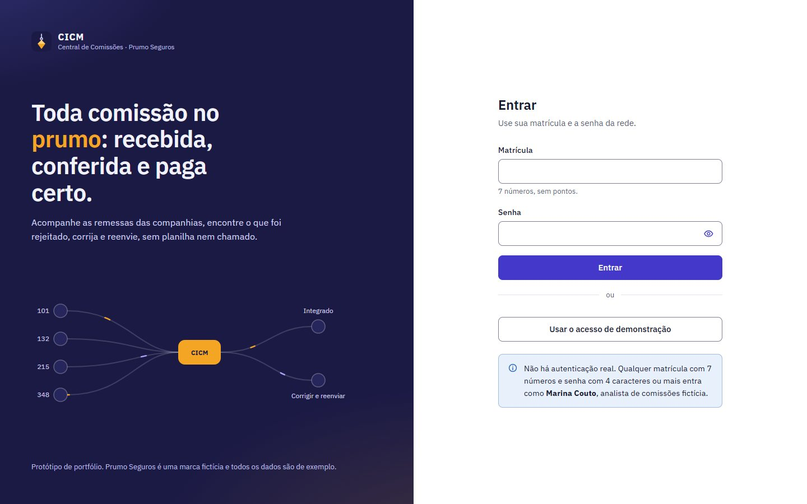 |  |

| Lista de erros com seleção | Correção no caso |
| --- | --- |
| 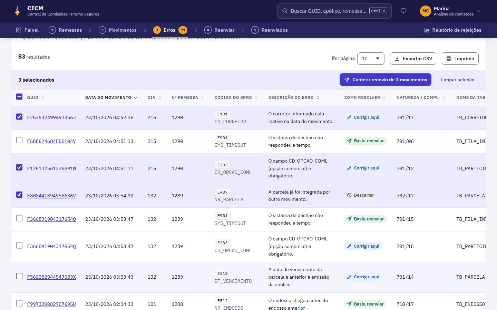 | 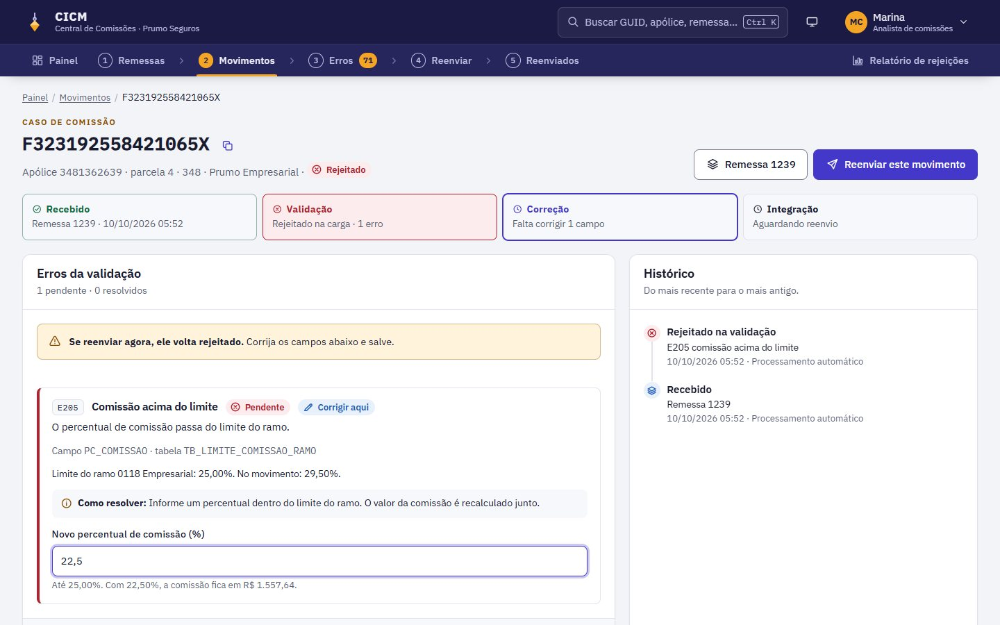 |

| Conferência do reenvio | Confirmação |
| --- | --- |
| 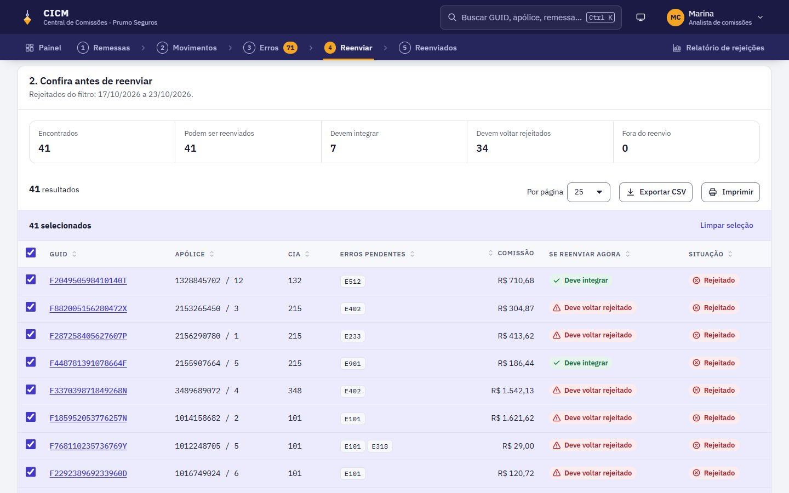 | 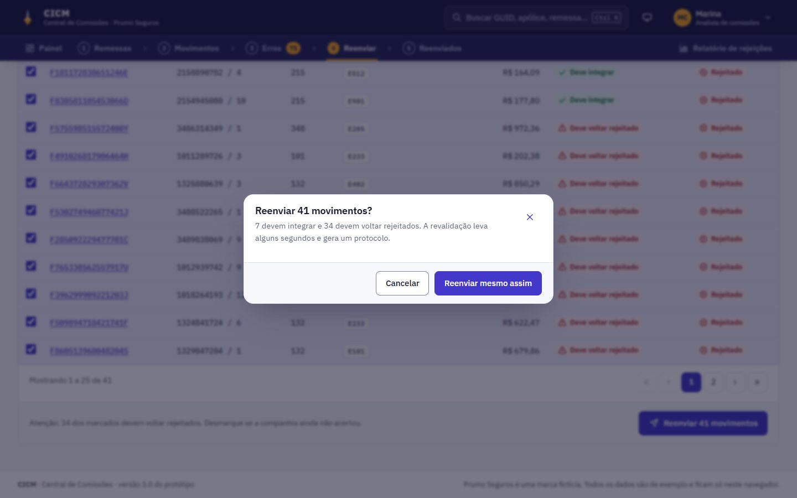 |

| Reenvio em processamento | Resultado do reenvio |
| --- | --- |
| 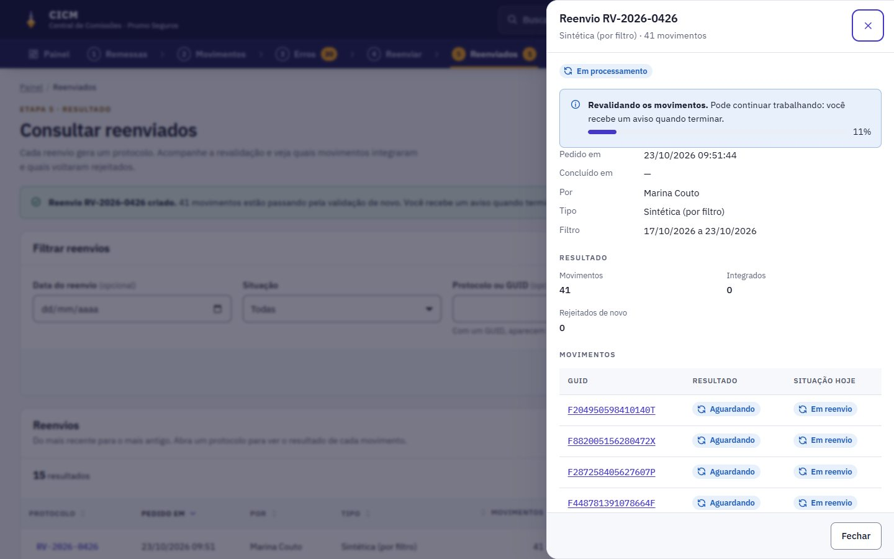 | 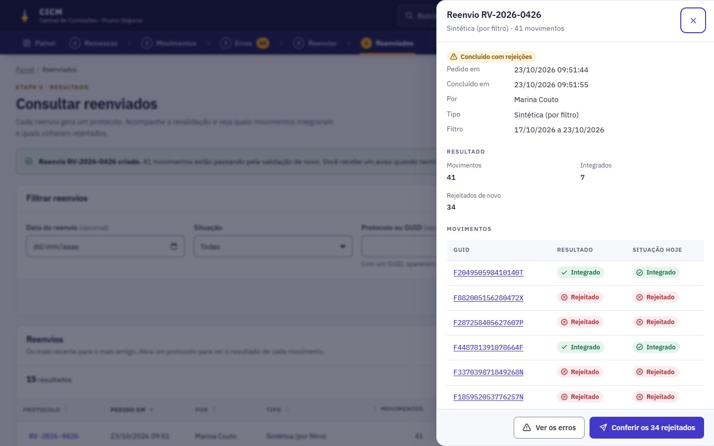 |

| Remessa rejeitada | Relatório de rejeições |
| --- | --- |
| 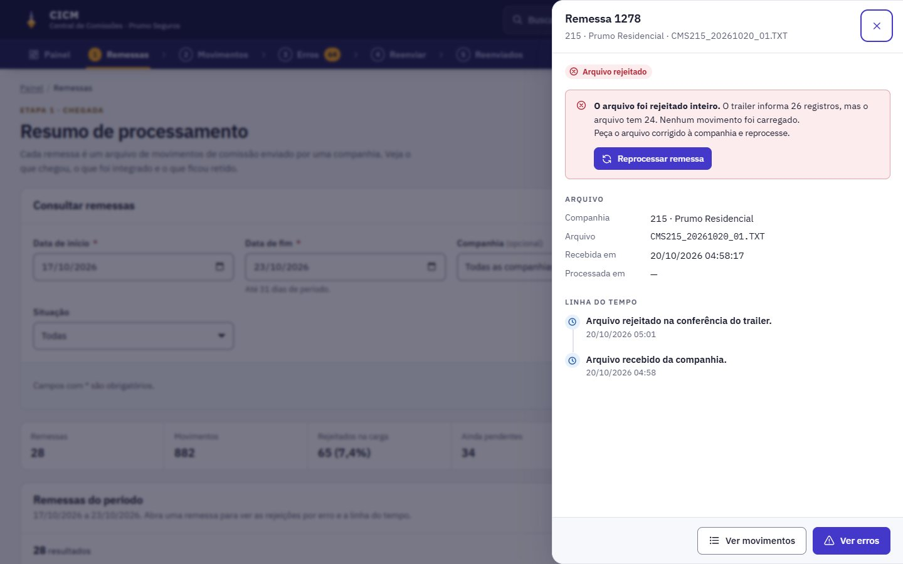 | 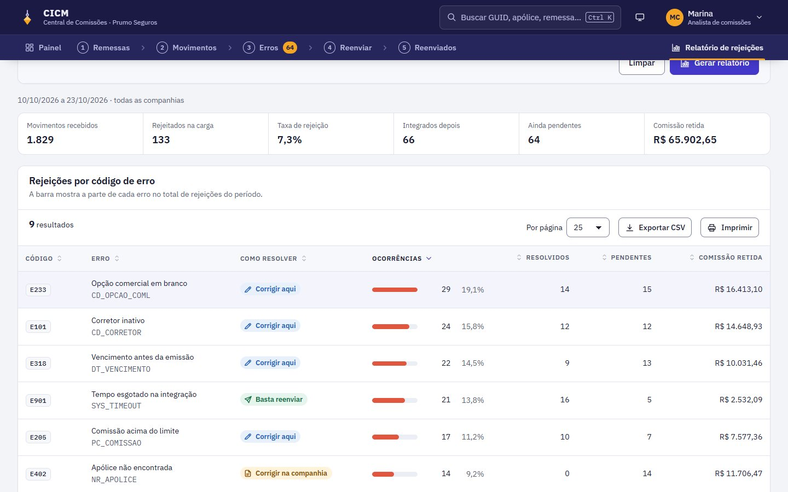 |

| Paleta de comandos | Tema escuro |
| --- | --- |
| 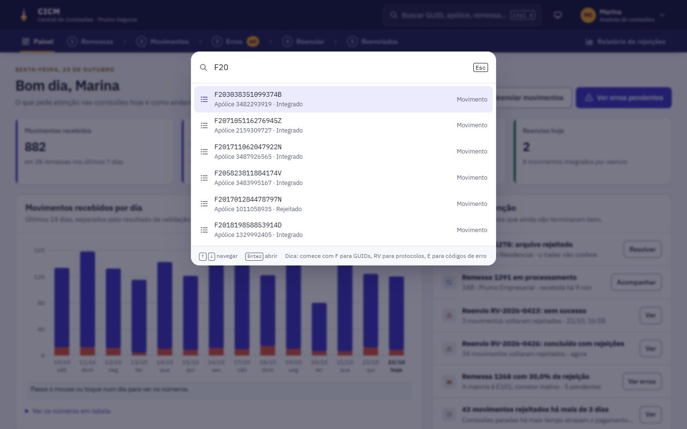 | 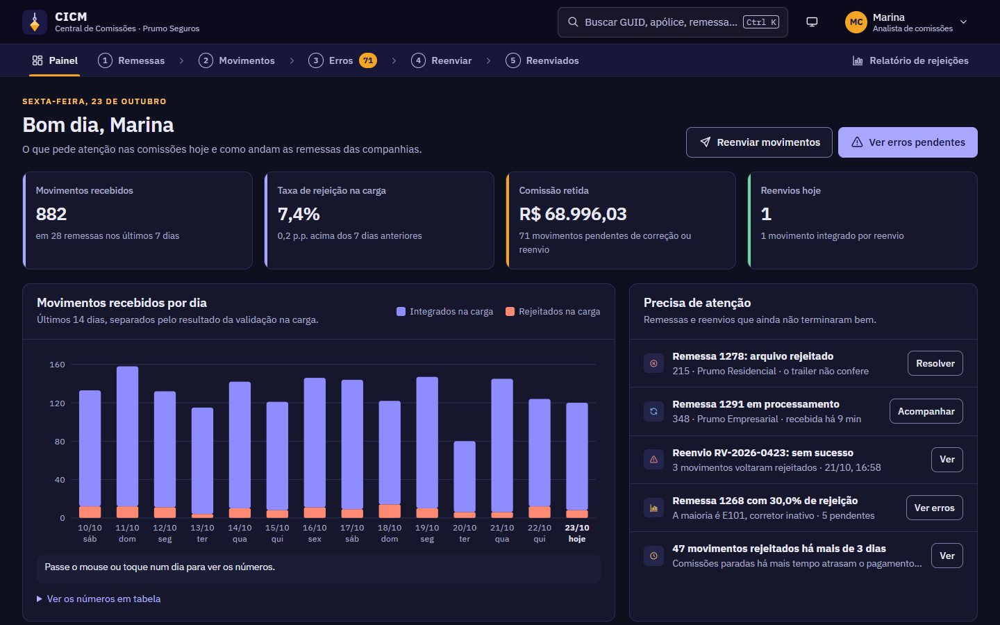 |

| Celular | Menu no celular | Erros no celular |
| --- | --- | --- |
| 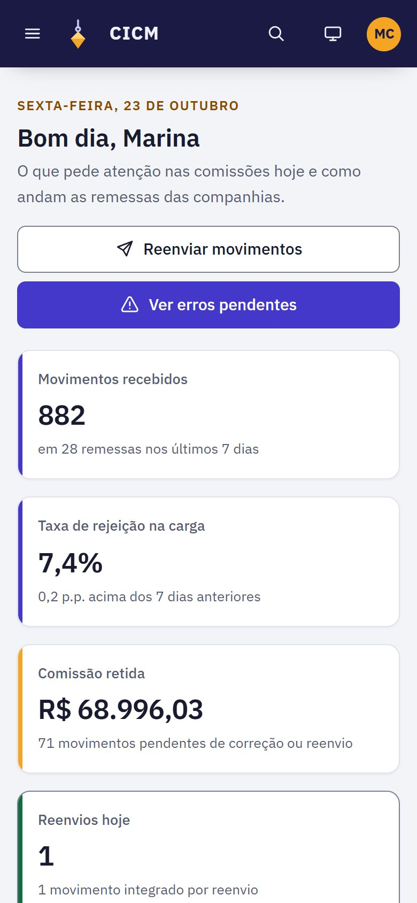 | 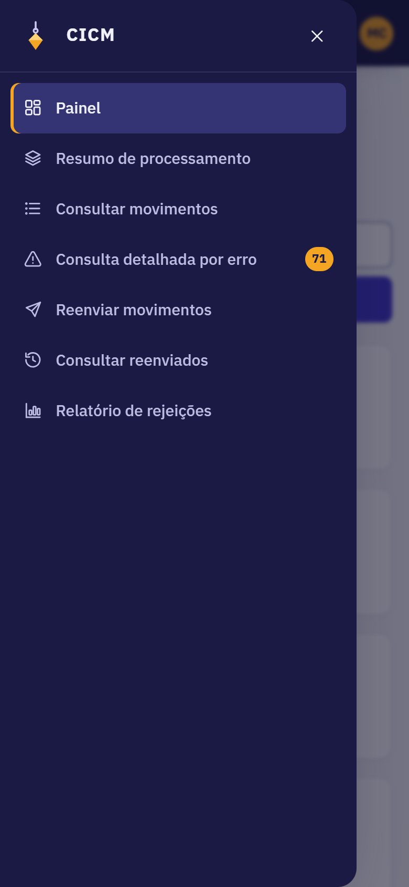 | 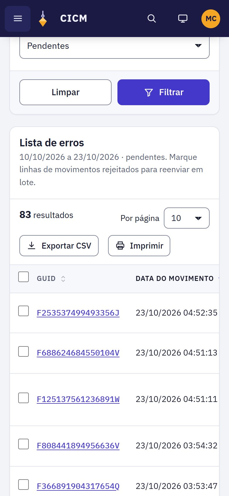 |

| Tela | Arquivo | O que faz |
| --- | --- | --- |
| Login | `login.html` | Matrícula e senha, com validação e acesso de demonstração. Não há autenticação real. |
| Painel | `painel.html` | Indicadores de 7 dias, gráfico de 14 dias, o que precisa de atenção, erros mais frequentes e últimas remessas. |
| Remessas | `remessas.html` | Resumo de processamento: remessas por período, companhia e situação, com totais e a gaveta de cada remessa. |
| Movimentos | `movimentos.html` | Consulta por caso de comissão (companhia, sucursal, ramo, apólice) ou sintética (período, situação, natureza, corretor, remessa). |
| Caso de comissão | `movimento.html?guid=...` | Etapas do movimento, erros com como resolver, correção, previsão, reenvio, descarte e histórico. |
| Erros | `erros.html` | Consulta detalhada por erro, por GUID ou sintética, com seleção em lote para reenviar. |
| Reenviar | `reenvio.html` | Por caso, por lista colada ou por filtro. Conferência com previsão e confirmação. |
| Reenviados | `reenviados.html` | Protocolos com progresso ao vivo e resultado por movimento. |
| Relatório | `relatorio.html` | Rejeições por código de erro, por companhia e por corretor. |

---

## O que funciona no protótipo

**Validação e correção**
- Os erros de dado são **calculados a partir do movimento**: corretor inativo, percentual acima do limite do ramo, comissão diferente de prêmio × percentual, opção comercial em branco e vencimento antes da emissão.
- A correção valida o novo valor (limite do ramo, vencimento depois da emissão, só corretores ativos) e mostra a comissão nova enquanto se digita.
- Erros de origem (apólice não encontrada) continuam até a companhia resolver. Parcelas duplicadas pedem descarte, com motivo obrigatório.

**Reenvio**
- Três modos: um GUID, uma lista colada (até 500, separados por linha, vírgula ou espaço, com repetidos e inválidos tratados) ou um filtro.
- Conferência com totais, previsão por movimento, motivo de quem fica de fora e seleção ajustável.
- Cada reenvio gera um protocolo `RV-aaaa-nnnn`. A revalidação leva alguns segundos, com progresso ao vivo e aviso no fim, em qualquer tela.
- Quem volta rejeitado fica com os erros que restaram, e o protocolo mostra "concluído com rejeições" ou "sem sucesso".

**Remessas**
- Situações calculadas: processada, com pendências, regularizada, em processamento e arquivo rejeitado.
- Uma remessa chega durante a visita: fica "em processamento" e os movimentos aparecem cerca de 45 segundos depois.
- Uma remessa com o trailer errado pode ser reprocessada.

**Em todas as listas**
- Filtros lembrados durante a sessão, ordenação, paginação, exportação para CSV e impressão.
- Links entre as telas: da remessa para os erros dela, do erro para o caso, do caso para o protocolo, do protocolo para os erros que restaram.
- **Restaurar dados de exemplo**, no menu da conta, volta tudo ao estado original.

---

## Acessibilidade

O protótipo foi revisado para a **WCAG 2.2 nível AA** e verificado com o
[axe-core](https://github.com/dequelabs/axe-core) em **64 combinações**: todas as telas e
os estados com erro, diálogo, gaveta, paleta, seleção e menus, nos temas claro e escuro,
no desktop e no celular, sem violações. A verificação roda no CI a cada mudança.

- **Estrutura**: landmarks, link para pular ao conteúdo, títulos em ordem, trilha de navegação e `aria-current` na etapa e na página.
- **Formulários**: rótulo visível em todos os campos, dicas ligadas por `aria-describedby`, erro no campo e num resumo no topo com links que levam ao campo.
- **Validação que não atrapalha**: o erro some enquanto a pessoa corrige, mas nenhum erro novo aparece no meio da digitação.
- **Tabelas**: legenda, cabeçalhos de linha e coluna, ordenação com `aria-sort` e anúncio, área rolável com foco de teclado, paginação nomeada e caixas de seleção com o nome do item.
- **Diálogos e gavetas** com `<dialog>` nativo: prendem o foco, fecham com Esc e devolvem o foco a quem abriu.
- **Paleta de comandos** no padrão combobox com lista, navegável por setas.
- **Status nunca só por cor**: cada situação tem ícone e texto.
- **Gráfico** com descrição textual e a mesma informação numa tabela.
- **Anúncios** para leitores de tela: resultados de consulta, seleção, ordenação, tema e fim do reenvio.
- **Contraste** de pelo menos 4,5:1 em texto e 3:1 em bordas de campos nos dois temas, alvos de toque de 44 px, movimento reduzido e alto contraste do Windows.

---

## Tecnologias e arquitetura

- **HTML, CSS e JavaScript puros**, com módulos ES nativos, sem build, sem framework e sem bibliotecas de runtime.
- **IBM Plex Sans e IBM Plex Mono** via Google Fonts.
- **Ícones** num sprite SVG próprio (`img/icons.svg`).

```text
.
├── index.html            Redireciona para o login
├── login.html            Login
├── painel.html           Painel
├── remessas.html         Resumo de processamento
├── movimentos.html       Consulta de movimentos
├── movimento.html        Caso de comissão (?guid=...)
├── erros.html            Consulta detalhada por erro
├── reenvio.html          Reenviar movimentos
├── reenviados.html       Consulta de reenviados
├── relatorio.html        Relatório de rejeições
├── css/app.css           Design system (tokens, temas, densidade, componentes, impressão)
├── js/theme.js           Aplica tema e densidade antes da primeira pintura
├── js/db.js              Dados de exemplo, catálogo de erros e regras de negócio
├── js/ui.js              Estrutura, menus, avisos, diálogos, paleta e relógio de processamento
├── js/table.js           Tabela com ordenação, paginação, seleção, CSV e impressão
├── js/form.js            Validação declarativa e máscaras
├── js/views.js           Gavetas de remessa e de reenvio e peças compartilhadas
├── js/pages/*.js         Comportamento de cada página
├── tests/                Testes de fluxo e de acessibilidade (Playwright + axe)
├── img/                  Símbolo e sprite de ícones
└── docs/screenshots/     Capturas usadas neste README
```

**Regras de negócio separadas da tela.** `js/db.js` concentra o ciclo da comissão:
`validar()` encontra os erros a partir dos dados, `previsao()` diz o que aconteceria num
reenvio, `corrigir()`, `descartar()` e `reenviar()` mudam o estado e registram o
histórico, e `tick()` avança o que está em processamento. As telas só leem e chamam essas
funções.

**Catálogo de erros.** Cada erro tem campo, tabela, descrição, tipo de solução e o texto de
"como resolver". Para criar um erro novo, basta acrescentá-lo ao catálogo e, se for de
dado, à função `validar()`.

**Dados.** O "banco" é um objeto JSON no `sessionStorage` (chave `cicm:db`), criado na
primeira visita por um gerador determinístico: 14 dias de remessas de 4 companhias, cerca
de 1.800 movimentos, um pico de corretor inativo, uma remessa rejeitada, uma em
processamento e o histórico de reenvios dos dias anteriores. As datas são relativas ao dia
de hoje, para "remessa de ontem" sempre fazer sentido.

---

## Testes

A pasta `tests/` tem testes que abrem o protótipo num Chrome de verdade:

- **`e2e.mjs`**: login com validação, retorno após login, corrigir → reenviar → integrar, reenvio por lista com inválidos e já integrados, reprocessamento de remessa, paleta de comandos, consulta por caso, regra de período, tema lembrado e nenhum erro de console.
- **`a11y.mjs`**: a auditoria axe descrita em [Acessibilidade](#acessibilidade).
- **`capture.mjs`**: gera as capturas deste README.

```bash
cd tests
npm install
npm test            # fluxos e acessibilidade
npm run capturas    # refaz docs/screenshots
```

O site em si não depende de nada disso. O CI roda o HTMLHint, bloqueia código inline e
injeção de HTML e executa os testes a cada push e pull request.

---

## Como rodar localmente

O projeto é estático: basta servir a pasta com qualquer servidor HTTP. Abrir pelo
`file://` não funciona, porque os módulos ES e o sprite de ícones precisam de HTTP.

```bash
git clone https://github.com/fernandopinhel/CICM.git
cd CICM

# Opção 1: Python
python3 -m http.server 8080

# Opção 2: Node, sem instalar nada
node tests/serve.mjs   # abre em http://localhost:8642
```

Depois, acesse o endereço e clique em **Usar o acesso de demonstração**.

---

## Publicação no GitHub Pages

O site é publicado direto da branch `master` (**Settings → Pages → Deploy from a branch**,
pasta `/`). A cada merge na `master`, o GitHub atualiza o site em cerca de um minuto. O
arquivo `.nojekyll` faz o GitHub servir os arquivos como estão.

Endereço: <https://fernandopinhel.github.io/CICM/>

---

## Segurança e privacidade

- **Nenhum dado sai do navegador.** Não há back-end. Sessão e dados ficam no `sessionStorage` e somem ao fechar a aba. Só o tema e a densidade ficam no `localStorage`.
- **Content Security Policy** em todas as páginas: `script-src 'self'`, `style-src` sem `'unsafe-inline'`, `object-src 'none'`, `base-uri 'self'` e `form-action 'self'`. Só o Google Fonts é liberado como origem externa.
- **Sem JavaScript nem CSS inline**, e o CI bloqueia se aparecer.
- **Sem injeção de HTML.** Tudo é montado com `createElement` e `textContent`.
- **Retorno do login protegido**: o parâmetro `volta` só aceita páginas do próprio protótipo.
- **CSV seguro**: valores que começam com `=`, `+`, `-` ou `@` são neutralizados para não virarem fórmula no Excel.
- **Referrer Policy** `strict-origin-when-cross-origin` e `noindex` para buscadores.

O GitHub Pages não permite definir cabeçalhos HTTP, por isso a CSP vai em `<meta>` e
`frame-ancestors` não se aplica. Veja também o [SECURITY.md](SECURITY.md).

---

## Limitações

- É um **protótipo**: não há back-end, autenticação real nem integração com as companhias.
- Os dados vivem só na aba do navegador. Outra aba ou outro navegador começa do zero.
- O reprocessamento de remessa simula o arquivo corrigido. Não há upload de arquivo.
- A marca Prumo Seguros e todos os dados são fictícios. O repositório **não tem licença de código aberto**.

---

## Próximos passos

- [ ] Perfis de acesso: quem pode corrigir, quem só consulta e quem aprova descartes.
- [ ] Aprovação em dois passos para descartes e reenvios acima de um valor.
- [ ] Envio do relatório de erros de origem direto para a companhia, com prazo e retorno.
- [ ] Regras de correção em lote (por exemplo, trocar um corretor inativo em todos os movimentos dele).
- [ ] Os módulos que o menu original previa (ASSE e COBP), depois de entender o que cada um precisa.

---

## Histórico

### 2026-10: Case revisitado

- Grupo fictício Prumo Seguros, com o prumo como símbolo, no lugar da marca do cliente original.
- Reescrita completa em HTML, CSS e JavaScript puros, com tema claro e escuro, densidade compacta e paleta de comandos.
- Fluxos funcionais de ponta a ponta: remessas, movimentos, caso de comissão com correção, erros, reenvio com previsão, protocolos ao vivo e relatório.
- Acessibilidade revisada para a WCAG 2.2 AA, verificada com axe.
- Testes de fluxo e de acessibilidade com Playwright no CI.
- Saíram Bootstrap, jQuery, Popper, o datetimepicker, a fonte de ícones, o logotipo e as capturas da intranet do cliente, além do arquivo de layout original.

### 2019-11 a 2020-04: Versão original

Protótipo de alta fidelidade criado na empresa onde o projeto nasceu, com Bootstrap e jQuery.

---

## Autor

**Fernando Pinhel**, Fullstack Designer (UX/UI, Design Systems e Front-end)
[fernandopinhel.com.br](https://fernandopinhel.com.br) · [GitHub](https://github.com/fernandopinhel)
